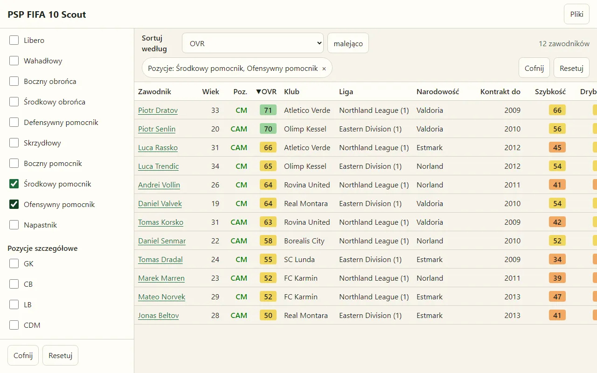
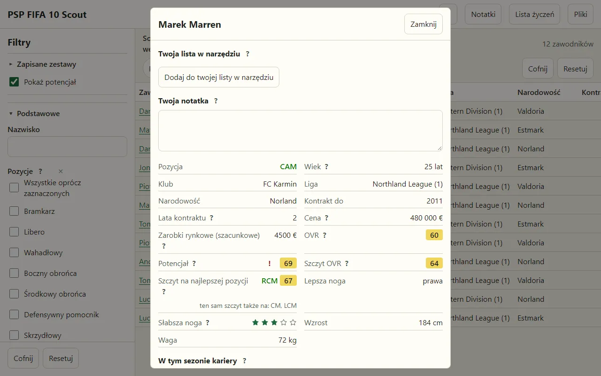

# PSP FIFA 10 Scout

A browser tool for the manager mode of FIFA 10 on the PlayStation Portable (also played in the
PPSSPP emulator): it reads the game's player database and your career save, and lets you filter and
compare players to find the ones worth signing.





The screenshots show a sample database of invented players and clubs, not the game's data.

## Status

Early development (November 2026). Use it at **<https://psp-fifa10-scout.visvaya.workers.dev/>**;
every change merged into `main` is published there after the checks pass. The interface is in Polish.

The current interface is a working draft: features come first, and its look and layout will change
in a planned redesign.

What it does today:

- Shows each player's potential, which the game does not show as a number. This needs only the
  player database.
- With a career save: projects each player's peak OVR, the rating he reaches by the game's
  development curves (at his preferred position the same as the game's development chart, without
  future gains from matches and training), and how much he still grows to it. The peak is counted
  at every position, and the list can show it at the position where it is highest, which need not
  be the one he plays best today. When several positions reach the same peak, you set the order of
  the rules that pick one (your club's formation, the weaker foot, the better foot's side, the
  preferred position).
- Draws each player's development curve from the game's data: a small chart on the card and a
  large one with his age this season, whether he is before, at or after his peak, and his peak
  period.
- Hides potential, the peak and the development curve by default; one switch reveals them.
- Reads the player database (`fifa.db`) straight from your disc image (ISO), or from a `fifa.db`
  file you extracted yourself. From the image it reads only the database, the language files, the
  game's identifier and its graphics.
- Shows the game's own club crests, nationality flags, league logos, player portraits and club kits
  beside their names, read from your ISO on your device. Where the game has no portrait of a player
  it shows the game's silhouette; an option shows the nearest portrait with the same face instead,
  and the card says what differs.
- With a career save, gives each player of your club a role in the squad (for example "2. CB": second
  in line for that place of your formation) and a state (to develop, to loan, to sell, declining and
  so on), and shows for players elsewhere the place they would take in your team, by today's OVR and
  by their peak.
- Optionally reads a manager-mode career save (`DATA.BIN` and `PARAM.SFO`): decrypts it, verifies
  its checksum and shows the current state of the career: clubs and leagues after promotions and
  relegations, contracts, loans, the transfer list, rolling match rating (KR), morale, injuries, the
  youth players generated during the career and the game's own shortlist. The save is remembered
  on the device, with a summary of what it holds.
- Shows club, league, country and position names in any language of the game: every language found
  in your ISO, or one `.loc` file you attach with its `string.idx`.
- Computes each player's overall rating (OVR) with the game's own formula at every position, and
  the rating at a position in each way the game rates it, with the gain over the OVR.
- In a career: shows league and cup appearances, goals, assists and clean sheets for the season.
- Prices players and wages with the game's formulas, and shows on the player card what an offer
  needs to succeed (fee, wage, contract length) or why the game would refuse any offer, for example
  when the club will not sell. Money shows in your career's currency or one you choose (pound, euro,
  dollar), with the game's rates and rounding.
- With a career save, can show every player outside your squad as he would be once signed: the game
  raises his potential by a fixed amount when he joins your squad, which can lift his OVR and peak
  too. The list, filters, sorting and card then use those values; the price and the offer stay as
  before the transfer.
- Shows each club's stars as the game computes them from its current squad, and the league and club
  prestige that feed the game's price and wage formulas.
- Filters by position, league, club, nationality, preferred foot, body type, development type and
  traits; by ranges of age, OVR, potential, peak OVR, attributes, contract end, price, wage and
  more; any list filter can also keep everyone except the chosen values. Filters and sorting can be
  saved as named sets, the last change can be undone, and each filter can show or hide its value as
  a list column. The list sorts by its column labels, and each player has a detail card.
- Keeps your own watchlist, without the game's limit of 20 players, and a note on any player, with a
  view of all your notes and a view of your watchlist or, with a career save, the game's shortlist.
- Installs as an app on a phone or a PC and works offline after the first visit. On an iPhone, pick
  the files in the Files app.

Supported game version: FIFA 10, European release `ULES01328`. Other releases are not supported.

## Your files, not ours

The tool works only with files you provide from your own copy of the game and your own saves. This
repository contains no game data: no disc image, no database and no saves. Everything is processed
locally in your browser; nothing is uploaded. Your settings, saved filter sets, watchlist and notes
stay in this browser on this device.

Where the files are:

- the disc image: wherever you keep your PPSSPP games;
- the career save: `PSP/SAVEDATA/ULES01328…` in the PPSSPP folder (select `DATA.BIN` and
  `PARAM.SFO` together).

## Development

Prerequisites: Node.js 26 (see `.nvmrc`) and pnpm 12 (pinned in `package.json`).

```sh
pnpm install   # also installs the git hooks
pnpm dev       # development server
pnpm build && pnpm preview   # production build, including the offline service worker
pnpm verify    # the full gate CI runs: format, text rules, typecheck, lint, tests, duplicates, dead code, build, size
pnpm test:e2e  # browser tests (Chromium and WebKit, with axe), on a synthetic database
pnpm make:screenshots  # after pnpm build: retakes the sample screenshots of the start page (public/screenshots)
pnpm measure:web-vitals  # lab LCP, CLS, TBT and bytes of the build (reports/web-vitals); CI runs it, advisory only
pnpm mutation  # mutation tests (Stryker); CI runs them every Sunday
```

Deployment: the `deploy` job in `.github/workflows/ci.yml` publishes the tested build to Cloudflare
Workers (configuration in `deploy/`, response headers in `public/_headers`), then
`scripts/check-deployment.ts` checks that the site serves exactly that build.

Source layout: `src/data` reads files (ISO, database, save decryption), `src/logic` holds the pure
player model, filters and ratings, and `src/ui` the React interface, with every user-facing text in
`src/ui/text.ts` and its `text-*.ts` parts. The one exception is the description of the tool on the
start page: it is static HTML in `index.html` (so it reads without running a script), and the app
moves that node onto the start screen.

Contributing: [CONTRIBUTING.md](CONTRIBUTING.md). Security reports: [SECURITY.md](SECURITY.md).

## License

GPL-3.0-or-later, see [LICENSE](LICENSE). The save decryption in `src/data/psp-save-crypto.ts` is
ported from [PPSSPP](https://github.com/hrydgard/ppsspp) (GPL-2.0-or-later); the file states its
origin.

## Disclaimer

This is an unofficial fan project. It is not affiliated with, endorsed or sponsored by Electronic
Arts, FIFA or Sony. FIFA 10 and PlayStation Portable are trademarks of their respective owners and
are named here only to describe what the tool works with.
